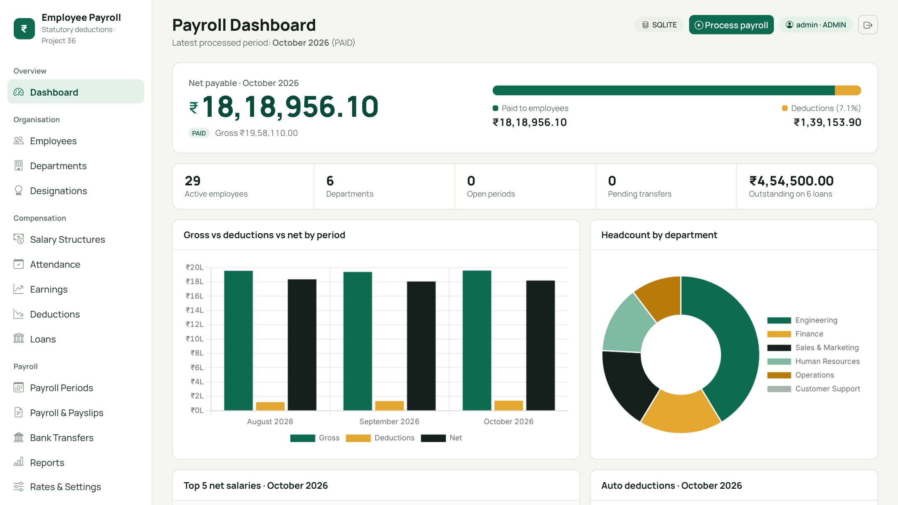

# Employee Payroll and Statutory Deduction Management System

**DBMS Project-Based Learning - Project 36** · G MADHAN (25WU0102344), AI ML RHINOS

A database-centred payroll system. The relational database is the single source of truth and enforces the rules
(keys, constraints, triggers); a Flask web application on top of it computes gross salary, statutory / loan / other
deductions and net salary per employee per month, and produces payslips, simulated bank-transfer records and reports.



> **Honest scope.** All data is **synthetic** (invented names, `example.com` e-mails, fake bank accounts).
> Deduction rates are **illustrative and editable**, not official statutory rates - do not use for real payroll.
> Bank transfers are **simulated records**; there is no bank API.

## Highlights
| Area | What is implemented |
|---|---|
| Database | 16 tables in 3NF, 16 PK / 17 FK / 14 UNIQUE / 23 CHECK / 8 indexes, 3 reporting views, 6 triggers |
| Integrity in the database | Triggers lock payroll history once a period is no longer OPEN; `ON DELETE RESTRICT` protects paid history |
| Audit trail | Triggers write `audit_log` rows when a salary structure, an employee's status or a payroll rate changes |
| Payroll engine | One transaction per run (all-or-nothing), once per period, `OPEN -> PROCESSED -> PAID` |
| Security | Login with roles **ADMIN / HR / EMPLOYEE**, salted PBKDF2 password hashes, CSRF tokens on every form, login throttling, employees see only their own payslips, **forgot-password** with signed, expiring, single-use reset links |
| Look and feel | Self-hosted Manrope font (works offline), amounts in Indian format (₹1,23,456.00), payslips with the amount in words |
| Database Explorer (admin) | Live table / column / foreign-key / view / trigger browser, audit log, and a **read-only SELECT console** (read-only connection, 5 s timeout, 200 rows) |
| Reports | 7 SQL reports, each with a "View SQL" button; payroll register CSV export |
| Backends | SQLite (default, zero setup) **and MySQL 8** - both tested (see Testing) |

## Roles
| Role | Can do |
|---|---|
| ADMIN | everything, plus rates & settings, user accounts, Database Explorer |
| HR | employees, salaries, attendance, loans, payroll processing, payslips, transfers, reports |
| EMPLOYEE | view own profile, loans and payslips only |

Demo accounts (local, synthetic) are created by `python scripts/init_db.py`: `admin`, `hr`, `emp001`...`emp005`.
They all use the password in `DEMO_PASSWORD` (default `Payroll@2026`, set in `.env`). **Change it** and do not expose the demo to a network.

## Quick start (SQLite, no database server needed)
```bash
python -m venv .venv
source .venv/bin/activate            # Windows PowerShell: .venv\Scripts\Activate.ps1
pip install -r requirements.txt
python scripts/init_db.py            # builds instance/payroll.db, loads data, runs demo payroll for Aug + Sep 2026
python run.py                        # open http://127.0.0.1:5000  and sign in as admin
```
October 2026 is left **OPEN** so you can click *Process payroll* yourself.

## Using MySQL 8
```bash
cp .env.example .env                 # set DB_BACKEND=mysql and the MYSQL_* values
# in MySQL:  CREATE DATABASE payroll_db CHARACTER SET utf8mb4;  (+ a user with ALL on it)
python scripts/init_db.py            # drops and recreates every table in that database!
python run.py
```
Triggers need either the `SUPER` privilege or `SET GLOBAL log_bin_trust_function_creators = 1;` when binary logging is on - see `docs/SETUP.md`.

## Project layout
```
app/                Flask app: routes, auth, payroll engine, CRUD config, reports, dbinfo (explorer), templates, static
database/           mysql/schema.sql (master DDL), sqlite/schema.sql (generated), seed.sql, views.sql,
                    mysql|sqlite/triggers.sql, queries.sql (CRUD, joins, GROUP BY, subqueries, reports, triggers)
scripts/            init_db.py, generate_seed.py, build_sqlite_schema.py, capture_screenshots.py, collect_facts.py, pptx/
tests/              test_app.py (74 SQLite tests), test_mysql.py (11 tests on a real MySQL server), recorded results
presentations/      Project36_DBMS_Review2.pptx, Project36_DBMS_Review3.pptx
review1/            the original Review 1 PDF
screenshots/        real screenshots of the running app (review2_stage/ = Review 2 state)
docs/               report, ER diagram, setup, testing, assumptions, demo script, GitHub upload guide, slide scripts
.github/workflows/  CI: SQLite job and MySQL 8 job
```

## Testing
```bash
python -m unittest discover -s tests                     # 74 tests on SQLite (11 MySQL tests are skipped)
# MySQL (throw-away database!):  PAYROLL_MYSQL_TESTS=1 MYSQL_USER=... MYSQL_PASSWORD=... MYSQL_DATABASE=payroll_test \
python -m unittest tests.test_mysql -v
```
Recorded: 74 / 74 on SQLite (`tests/test_results.txt`) and 11 / 11 on MySQL 8.0.46 (`tests/test_results_mysql.txt`). Details: `docs/TESTING.md`.

## Payroll rules (illustrative, editable under Rates & Settings)
`gross = fixed - loss of pay + extra earnings`; PF 12% of basic (basic capped at 15,000); ESI 0.75% of gross if gross <= 21,000;
professional tax 200 if gross > 15,000; TDS 5% of gross above 50,000; loan EMI = min(EMI, outstanding); `net = gross - total deductions`.
Worked example (EMP003, Oct 2026): gross 1,00,130 - (1,800 + 200 + 2,506.50 + 5,000) = **90,623.50**. More in `docs/ASSUMPTIONS.md`.

## Database design
See `docs/ER_DIAGRAM.md` (Mermaid ER diagram that GitHub renders) and `database/mysql/schema.sql`.

## Limitations
Simulated bank transfers; illustrative rates; single-server demo (no HTTPS / deployment hardening, in-memory login throttle);
password-reset links are shown on screen because there is no e-mail server; small synthetic data set; MySQL tested on one local server version (8.0.46).

## Links
- GitHub repository: https://github.com/Madhang12/DBMS_2344_PROJECT36_PAYROLL
- Demo video: https://drive.google.com/file/d/1FA6l8YMcu4JHd_9D2KsfjU_lk6wlybD5/view?usp=drive_link

Licence: MIT (see `LICENSE`).
