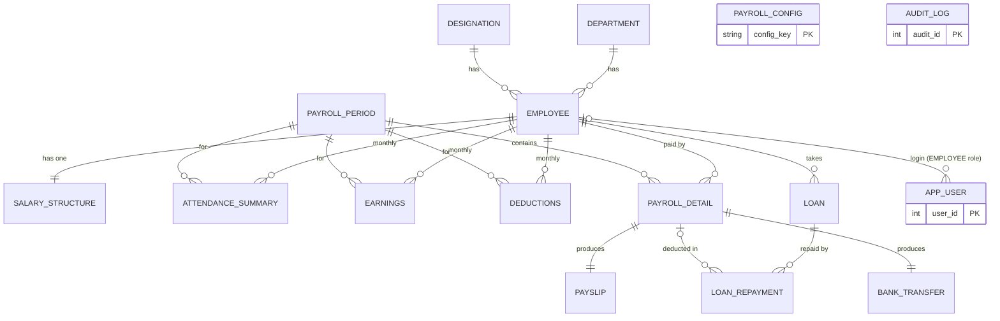

# Final ER diagram (16 tables)

GitHub renders the diagram below directly. Crow's-foot notation: `||--o{` = one-to-many, `||--||` = one-to-one.

`PAYROLL_CONFIG` (editable illustrative rates) and `AUDIT_LOG` (written only by database triggers) have no foreign keys by design.
Views: `v_payroll_summary`, `v_department_cost`, `v_loan_ledger`. Triggers: see `database/sqlite/triggers.sql` and `database/mysql/triggers.sql`.
